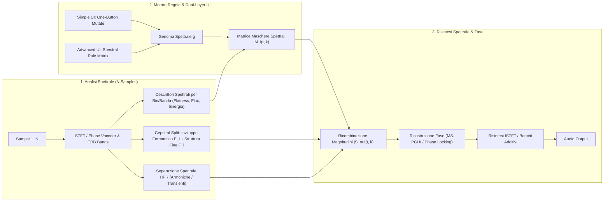

# SpecTile: Rule-Based Multi-Sample Spectral Mosaicing and Chimeric Resynthesis Between Macro-Simplicity and Micro-Control

> [!TIP]
> **Target Conferenze Ideali:** *SMC (Sound and Music Computing)*, *DAFx (Digital Audio Effects)*, *NIME (New Interfaces for Musical Expression)*, *ICMC*, oppure il *CIM (Colloquio di Informatica Musicale)*.
> **Focus Rigoroso:** Sintesi e Risintesi puramente **Spettrale** (STFT / Phase Vocoder / Sinusoidal & Additive Resynthesis / Spectral Filtering). Riferimenti come *Portal* o *Synplant* sono confinati esclusivamente al paradigma ergonomico dell'interfaccia a doppio livello (*One-Button vs. Deep View*).

---

## Abstract (IT & EN)

**Italiano:**
La risintesi spettrale, la *cross-synthesis* e la mutazione dei bin FFT rappresentano tecniche storiche nella musica elettroacustica per la creazione di morfologie sonore ibride ("chimere acustiche"). Tuttavia, gli ambienti di ricerca esistenti (*AudioSculpt/SuperVP*, *SPEAR*, *SoundHack*, *FFTease*) richiedono operazioni manuali laboriose o configurazioni tecniche complesse, mentre i sintetizzatori e processori spettrali commerciali soffrono di limiti strutturali opposti: strumenti come *iZotope Iris 2* permettono di combinare porzioni di spettro da più campioni ma costringono l'utente a disegnare manualmente le maschere col lazo su ciascuno spettrogramma; sintetizzatori a risintesi additiva/spettrale come *VirSyn Cube* o *Camel Audio Alchemy* si limitano a un'interpolazione globale continua (pad XY) tra un massimo di 4 sorgenti; effetti come *Zynaptiq MORPH* o *Melda MMorph* operano solo su 2 flussi via sidechain. Questo articolo presenta **SpecTile**, un'architettura di sintetizzatore/campionatore spettrale VST3/AU progettata per generare suoni chimerici attraverso la scomposizione e ricombinazione automatica di tasselli tempo-frequenza (*spectral tiles*), parziali e bande spettrali estratti da un pool di $N$ campioni caricati dall'utente. Il motore DSP combina l'analisi STFT/Sinusoidale, la decomposizione *Harmonic-Percussive-Residual (HPR)* e la fattorizzazione *Source-Filter* con quattro famiglie di regole generative (tassellazione geometrica di Voronoi/Perlin 2D nel piano tempo-frequenza, selezione competitiva dei bin guidata da descrittori spettrali, *interleaving* armonico e ricostruzione coerente di fase tramite *Phase Gradient Heap Integration* – PGHI). Sul piano dell'interazione, *SpecTile* supera la "paralisi analitica" tipica dei sintetizzatori spettrali introducendo un'interfaccia *Dual-Layer*: una vista minimale *One-Button* per generare mutazioni spettrali istantanee ma musicalmente vincolate, affiancata a una vista espandibile (*Deep Rule Matrix*) per la configurazione chirurgica delle regole di allocazione spettrale.

**English:**
*Spectral resynthesis, cross-synthesis, and FFT bin mutation are foundational techniques in electroacoustic music for crafting hybrid sound morphologies ("acoustic chimeras"). However, existing academic tools (AudioSculpt/SuperVP, SPEAR, SoundHack, FFTease) demand labor-intensive manual workflows, whereas commercial spectral VSTs face structural trade-offs: instruments like iZotope Iris 2 allow combining spectral regions from multiple samples but force users to manually paint masks on static spectrograms; spectral/additive resynthesizers such as VirSyn Cube or Camel Audio Alchemy rely on global X/Y crossfading across at most 4 sources; and processors like Zynaptiq MORPH operate strictly on 2 sidechain streams. This paper presents **SpecTile**, a spectral synthesizer VST3/AU architecture that generates chimeric sounds by automatically slicing and recombining time-frequency patches ("spectral tiles"), partials, and frequency bands drawn from a user-loaded pool of $N$ audio samples. The DSP engine pairs STFT/Sinusoidal analysis, Harmonic-Percussive-Residual (HPR), and Source-Filter decomposition with four families of generative rules (2D Voronoi/Perlin time-frequency tiling, feature-driven competitive bin selection, harmonic interleaving, and coherent phase reconstruction via Phase Gradient Heap Integration – PGHI). To overcome the "analytical paralysis" typical of spectral workstations, SpecTile adopts a Dual-Layer UI: a minimal One-Button view for instant, musically constrained spectral mutations, expandable into a Deep Rule Matrix for surgical control.*

---

## 1. Introduzione

Nella composizione elettroacustica e nel sound design contemporaneo, la sintesi di timbri inediti a partire da suoni registrati si fonda sull'analisi e sulla manipolazione diretta dello spettro sonoro e della sua evoluzione spettromorfologica (Smalley, 1997). Fin dagli anni '90, tecniche come la *Spectral Mutation* nel Phase Vocoder (Polansky & Erbe, 1996), il tracciamento sinusoidale (McAulay & Quatieri, 1986; Serra & Smith, 1990) e il *Musical Mosaicing* nel dominio tempo-frequenza (Zils & Pachet, 2001; Driedger et al., 2015) hanno mostrato il potenziale dell'innesto di micro-componenti spettrali provenienti da sorgenti eterogenee per generare **chimere acustiche** (*auditory chimeras*, Wishart, 1994; Smith et al., 2002): oggetti sonori che fondono, ad esempio, i bin d'attacco inarmonici di un metallo, le parziali formantiche di una voce e le bande ad alta frequenza di un fruscio d'acqua.

Nonostante la maturità matematica di queste tecniche, chi utilizza oggi strumenti di **sintesi spettrale** all'interno di una DAW si scontra con tre colli di bottiglia:
1. **L'onere della selezione manuale (*Spectral Painting*):** Campionatori spettrali commerciali come **iZotope Iris 2** o ambienti come **AudioSculpt** e **MetaSynth** permettono di isolare porzioni di spettro da campioni diversi, ma richiedono che l'utente disegni manualmente col lazo o col pennello ogni singola regione tempo-frequenza, rendendo impossibile l'esplorazione generativa rapida su molti campioni.
2. **Il limite del Morphing Globale o Dual-Stream:** Sintetizzatori a risintesi spettrale/additiva come **VirSyn Cube** e **Camel Audio Alchemy** caricano fino a 4 sorgenti, ma si limitano perlopiù a un'interpolazione globale (pad XY) tra gli spettri interi; analogamente, processori come **Zynaptiq MORPH** o **Melda MMorph** richiedono un routing sidechain e operano solo su **2 flussi** (A + B).
3. **La "Paralisi Analitica" delle interfacce spettrali:** Plugin potentissimi nella manipolazione dei bin FFT come **Unfiltered Audio SpecOps**, **Image-Line Harmor** o **Michael Norris Spectral** espongono decine di parametri matematici ma mancano di un livello di astrazione generativo immediato.

**Contributi del lavoro:**
1. **Rule-Based Multi-Sample Spectral Mosaicing:** Un motore di sintesi spettrale che carica $N$ campioni, ne analizza gli spettri e assembla nuovi timbri ricombinando *tessere tempo-frequenza*, bande ERB e parziali secondo regole matematiche e descrittori spettrali, automatizzando e superando il *lasso painting* manuale di *iZotope Iris 2*.
2. **Coerenza Spettrale e Ricostruzione di Fase (MS-PGHI):** Un'architettura di risintesi che evita il *musical noise* e le cancellazioni di fase tipiche del *bin-switching* tramite *2D Spectral Feathering*, disaccoppiamento Inviluppo/Struttura Fine e ricostruzione del gradiente di fase (*PGHI*).
3. **Paradigma di Interazione Dual-Layer ("One-Button to Rule-Matrix"):** Un'interfaccia che separa l'esplorazione creativa immediata (un singolo pulsante di mutazione spettrale ispirato all'ergonomia macro di *Synplant 2 / Portal*) dal laboratorio di configurazione profonda delle regole spettrali.

---

## 2. Related Work: Sintesi Spettrale in Elettroacustica e nei VST Commerciali

### 2.1 Strumenti Storici nella Musica Elettroacustica e Computer Music
* **Spectral Mutation e Bin-Level Compositing (SoundHack & FFTease):** In *SoundHack*, Polansky & Erbe (1996) hanno introdotto la *Irregular Spectral Mutation (ISM)*, che ibrida i frame del Phase Vocoder di due file audio scegliendo probabilisticamente, bin per bin, l'ampiezza e la fase della sorgente A o della sorgente B. Nel 2000, Lyon & Penrose hanno portato il *compositing spettrale* in tempo reale su Max/MSP con la collezione **FFTease**: l'oggetto `ether~` seleziona per ciascun bin FFT il segnale con energia maggiore (o minore) tra due input, mentre `morphine~` ordina i bin per magnitudine interpolando tra i due spettri.
* **Modellazione Sinusoidale + Residua (SMS) e SuperVP:** A partire dal modello *Deterministic plus Stochastic* di Xavier Serra (1990), software come **SPEAR** (Klingbeil) e **IRCAM AudioSculpt / SuperVP** (Bogaards et al., 2004) hanno permesso il filtraggio di superfici spettrali e la *cross-synthesis* generalizzata (incrociando l'inviluppo formantico *True Envelope* di un suono con l'eccitazione spettrale di un altro).
* **NMF Spectral Mosaicing & Orchestrazione Assistita:** Driedger et al. (2015, *"Let It Bee"*) hanno dimostrato come la **Non-Negative Matrix Factorization (NMF)** permetta di decomporre un pool di campioni in piccoli template spettrogrammatici (*time-frequency tiles*) per ricostruire spettri complessi a mosaico; sul versante strumentale, **Orchidea** (Carpentier & Bresson, 2010) combina campioni multipli tramite ottimizzazione spettrale multi-obiettivo.

### 2.2 Sintetizzatori e Processori Spettrali VST Commerciali
Per posizionare rigorosamente **SpecTile**, analizziamo i principali plugin commerciali basati **esclusivamente su sintesi/risintesi spettrale, additiva e FFT** (Tabella 1):

* **iZotope Iris 2 (2014):** È il precursore commerciale più diretto. Carica fino a 4 file audio e ne mostra gli spettrogrammi sovrapposti. L'utente usa strumenti grafici in stile Photoshop (lazo, pennello, bacchetta magica) per disegnare maschere tempo-frequenza su ciascun livello, isolando piccoli "pezzi di spettro" da sommare e suonare via MIDI. *Limite:* Il processo è interamente manuale, statico (la maschera disegnata resta fissa) e limitato a 4 slot; manca qualsiasi motore generativo o basato su regole dinamiche.
* **VirSyn Cube 2 & Camel Audio Alchemy (Logic Pro):** Entrambi eseguono una vera **risintesi spettrale e additiva** (fino a 512 parziali sinusoidali + spettro di rumore in *Cube*; risintesi FFT/fase e formanti in *Alchemy*) su **4 sorgenti audio**. *Limite:* L'ibridazione avviene tramite un Morph Pad XY che esegue un *crossfade/interpolazione globale* tra i 4 spettri completi, anziché comporre un mosaico discreto in cui bande o micro-regioni diverse provengono da campioni diversi secondo regole morfologiche.
* **Image-Line Harmor, NI Razor & Tracktion Abyss:** Sintetizzatori puramente additivi/spettrali dove ogni filtro o modulazione agisce su tabelle di centinaia di parziali (*Harmor* converte campioni audio in 516 frequenze/ampiezze) o su gradienti spettrali polinomiali (*Abyss*). *Limite:* Lavorano su **1 o 2 sorgenti** per patch e richiedono una programmazione tecnica complessa.
* **Zynaptiq MORPH 3, Melda MMorph & SoundHack Spectral Shapers:** Processori FFT di cross-synthesis e morphing formantico in tempo reale. *Limite:* Sono effetti vincolati al paradigma **2-input (Main + Sidechain)**, incapaci di attingere autonomamente a una libreria di $N$ campioni.
* **Unfiltered Audio SpecOps, GRM Tools Spectral (Transform/Evolution/Fusion) & Michael Norris Spectral:** Workstation di manipolazione diretta dei bin FFT (*spectral freeze, bin scrambling, contrasto energetico dei bin, spectral mutation*). *Limite:* Elaborano un singolo flusso audio (o 2 in *Spectral Mutation*) con interfacce da laboratorio prive di generazione multi-sample.

| Plugin Spettrale / Sistema | Sorgenti ($N$) | Meccanismo di Scomposizione e Sintesi Spettrale | Selezione dei "Pezzi di Spettro" | Paradigma UI / Controllo Generativo |
| :--- | :---: | :--- | :--- | :--- |
| **iZotope Iris 2** | Fino a 4 sample | Filtraggio su spettrogramma ad alta risoluzione (RX engine) | **Manuale:** disegno col lazo/pennello sullo spettrogramma | Vista unica a spettrogramma; **nessun tasto generativo** |
| **VirSyn Cube 2 / Alchemy** | 4 sorgenti | Risintesi Additiva (512 parziali + rumore) & FFT/Formanti | **Interpolazione globale XY** tra i 4 spettri interi | Pad XY + pagine di editing delle parziali |
| **Image-Line Harmor** | 1–2 sample | Risintesi additiva/spettrale su 516 parziali + maschere | Manipolazione deterministica (Prism, Blur, Mask) | Interfaccia densa a moduli tecnici |
| **Zynaptiq MORPH 3 / MMorph** | 2 (A + Side B) | Cross-synthesis FFT, tracking formantico e interweaving | Trasferimento continuo A $\leftrightarrow$ B su pad XY | Effetto Sidechain a 2 canali; non multi-sampler |
| **SoundHack / M. Norris Spectral** | 1 o 2 flussi | Phase Vocoder: *Irregular Spectral Mutation* sui bin FFT | Scambio probabilistico/soglia bin-per-bin (solo 2 input) | Slider matematici; nessun motore multi-sample |
| **Unfiltered Audio SpecOps** | 1 flusso audio | Analisi/Risintesi STFT con 36 algoritmi sui bin di frequenza | Scomposizione multi-banda di un singolo input | Workstation modulare complessa |
| **SpecTile (Proposto)** | **$N$ sample ($2\dots 8$)** | **Risintesi STFT/HPR + Source-Filter & Tiling 2D (ERB/Parziali)** | **Automatica/Basata su Regole** (Voronoi, Descrittori, Markov) | **Dual-Layer:** *One-Button* Generativo + *Rule Matrix* |

---

## 3. Architettura DSP e Regole di Mosaico Spettrale

L'architettura di **SpecTile** è interamente fondata sul dominio della frequenza e si articola in tre stadi: (1) *Analisi Spettrale Multi-Sample*, (2) *Allocazione delle Tessere Spettrali basata su Regole*, e (3) *Risintesi Chimerica Coerente*.

### 3.1 Rappresentazione e Fattorizzazione dello Spettro
Al caricamento degli $N$ campioni $s_1(n), \dots, s_N(n)$, il sistema calcola la rappresentazione tempo-frequenza tramite STFT ad alta risoluzione (finestra di Hann/Gaussiana a 2048 o 4096 punti, overlap 75%–87.5%) e raggruppa i bin FFT $k$ in $B$ bande psicoacustiche su scala **ERB (Equivalent Rectangular Bandwidth)** o **Bark** (configurabili fino alla risoluzione del singolo bin FFT). Ogni spettro $S_i(t, k)$ viene scomposto in:
1. **Componente Armonica, Percussiva e Residua (HPR):** Filtraggio mediano direzionale sullo spettrogramma di magnitudine (Fitzgerald, 2010) per separare i picchi sinusoidali orizzontali $H_i(t, k)$ (parziali stabili) dalle creste verticali a banda larga $P_i(t, k)$ (attacchi transienti) e dal fondo stocastico $R_i(t, k)$.
2. **Fattorizzazione Source-Filter (True Envelope + Struttura Fine):** Tramite *Cepstral Liftering* (o *Discrete Cepstrum* in stile *SuperVP*), il modulo spettrale di ciascun frame viene fattorizzato nell'inviluppo formantico liscio $E_i(t, k)$ e nella micro-struttura fine (armoniche e rumore) $F_i(t, k)$:
   $$|S_i(t, k)| = E_i(t, k) \cdot F_i(t, k)$$
3. **Descrittori Spettrali Locali:** Per ogni regione tempo-frequenza $(t, b)$ vengono calcolati l'energia locale, la *Spectral Flatness* (indice di rumorosità vs. sinusoidalità), lo *Spectral Flux* locale e la deviazione di frequenza istantanea.

### 3.2 Quattro Famiglie di Regole per Assemblare i "Pezzi di Spettro"
Al posto del disegno manuale col lazo (*Iris 2*), **SpecTile** calcola una matrice di mascheramento spettrale $M_i(t, k) \in [0, 1]$ (con $\sum_{i=1}^N M_i(t, k) = 1$) usando quattro famiglie di regole combinabili:

* **Regola 1 – Tassellazione Spettrale Geometrica (Voronoi 2D, Perlin & Spectral Interleaving):**
  * *Spectral Interleaving (Pettine Armonico):* Assegna ciclicamente i bin o le bande ERB tra i campioni: $M_i(t, b) = 1 \iff (b \bmod N) = i$ (es. parziali dispari dal Sample 1, parziali pari dal Sample 2, alte frequenze dal Sample 3).
  * *Tassellazione di Voronoi e Campi di Perlin nel piano $(t, \log f)$:* Genera "isole" spettrali organiche distribuendo semi $(t_q, f_q)$ nel piano tempo-frequenza. Variando i parametri di scala $(\sigma_t, \sigma_f)$ si passa da micro-frammenti spettrali ($10\text{ ms} \times 1\text{ ERB}$) a larghe fasce formantiche evolutive.
* **Regola 2 – Selezione Competitiva Guidata da Descrittori (*Feature-Driven Bin Allocation*):**
  Ogni tassello spettrale $(t, b)$ viene assegnato valutando una regola morfologica (Smalley, 1997) sugli $N$ spettri:
  * *Split Spettromorfologico (Onset / Continuant):* Nelle zone dello spettro dove lo *Spectral Flux* supera una soglia $\theta$, i bin vengono prelevati dal campione designato per gli attacchi; nelle zone stazionarie subentrano i bin armonici degli altri campioni.
  * *Competizione Energetica o Tonale (estensione multi-sample di `ether~` in FFTease):* Per ogni banda $(t, b)$, vince il campione con la *Spectral Flatness* più bassa (massima purezza armonica) oppure quello con l'energia relativa più alta/bassa (permettendo a campioni deboli di riempire i "buchi spettrali" lasciati liberi dai campioni dominanti, evitando lo *spectral masking*).
* **Regola 3 – Continuità Markoviana nel Piano Tempo-Frequenza:**
  Una catena di Markov bidimensionale regola la probabilità di persistenza $P_{\text{stay}}$ lungo l'asse del tempo $t \to t+1$ e della frequenza $b \to b+1$, impedendo che lo scambio rapido di bin tra campioni diversi degeneri in rumore bianco incoerente.
* **Regola 4 – Cross-Synthesis Locale per Tessera (Inviluppo $\times$ Struttura Fine):**
  Applicando due maschere distinte $M^{\text{env}}_i(t, k)$ e $M^{\text{fine}}_j(t, k)$, ogni singola regione dello spettro può combinare le formanti $E_i$ di un campione con le parziali armoniche $F_j$ di un altro:
  $$|S_{\text{out}}(t, k)| = \left( \sum_{i=1}^N M^{\text{env}}_i(t, k) E_i(t, k) \right)^\gamma \cdot \left( \sum_{j=1}^N M^{\text{fine}}_j(t, k) F_j(t, k) \right)$$

### 3.3 Coerenza ai Confini dei Bin e Ricostruzione di Fase (MS-PGHI)
Quando si affiancano nel dominio FFT porzioni di spettro provenienti da $N$ campioni non correlati, il salto brusco tra bin adiacenti provoca *ringing* (effetto Gibbs) e cancellazioni di fase tra frame successivi. **SpecTile** risolve entrambi i problemi:
1. **2D Spectral Feathering:** Le maschere $M_i(t, k)$ vengono convolute con un kernel Gaussiano 2D nel piano tempo-frequenza per creare uno smusso (*cross-fade* spettrale) di ampiezza configurabile tra bin adiacenti.
2. **Multi-Source Phase Gradient Heap Integration (MS-PGHI):** Invece di incollare le fasi grezze $\phi_i(t, k)$ dei campioni originali (che sono incoerenti tra loro), il sistema calcola i gradienti tempo-frequenza del log-spettrogramma ibrido $\log |S_{\text{out}}(t, k)|$ e integra una nuova fase matematicamente coerente in tempo reale tramite l'algoritmo non-iterativo **PGHI** (Průša et al., 2017). Il parametro **Phase Glue** permette di dosare continuamente tra le fasi originali (*Identity Phase-Locked* secondo Laroche & Dolson, 1999), la fase ricostruita *PGHI* (suono ultra-nitido e fuso) e la dispersione stocastica di fase (*spectral blur/freeze*).

---

## 4. Design dell'Interfaccia: Dal "One-Button" alla Matrice Spettrale

Mentre i motori DSP sono puramente spettrali, il design dell'interazione trae ispirazione dai più riusciti paradigmi *Dual-Layer* moderni (come la separazione tra vista immediata e vista profonda vista in *Synplant 2* o *Output Portal*), applicandoli per la prima volta al **mosaicing spettrale multi-campione**.

### 4.1 Livello 1: La Vista Semplice ("The Chimera Button")
Pensata per chi vuole generare immediatamente nuovi suoni spettrali senza disegnare maschere a mano:
* **Slot Spettrali ($S_1 \dots S_N$):** L'utente trascina da 2 a 8 campioni, ciascuno identificato da un colore.
* **Il Pulsante Centrale ("Generate / Mutate Spectrum") e Rami Genetici:**
  Un clic sul tasto centrale campiona un **Genoma Spettrale $\mathbf{g} \in [0, 1]^D$** a partire da *Archetipi di Regole* pre-calibrati (es. *Harmonic Interleave*, *Transient-Formant Graft*, *Voronoi Spectral Shatter*, *Complementarity Fill*). Attorno al pulsante centrale si aprono 6 **rami evolutivi**: muovendo il cursore lungo un ramo si ascolta l'interpolazione continua delle maschere spettrali $M_i(t, k)$ verso nuove mutazioni del mosaico.
* **3 Controlli Macro & Spettrogramma Policromatico:**
  1. **Spectral Tile Size ($\Delta t \times \Delta f$):** Dalla fusione a larghe bande formantiche al micro-mosaico sui singoli bin FFT.
  2. **Rule Order vs. Mutation:** Da regole deterministiche basate sui descrittori (es. separazione rigorosa attacco/armoniche) a tassellazioni stocastiche.
  3. **Phase & Spectral Glue:** Controlla simultaneamente il *feathering* 2D tra i bin e la ricostruzione di fase *MS-PGHI*.
  Al centro, uno **spettrogramma policromatico in tempo reale** colora ogni regione $(t, k)$ dello spettro con la tinta del campione sorgente attivo, rendendo visibile a colpo d'occhio la struttura del mosaico spettrale.

### 4.2 Livello 2: La Vista Configurabile ("Deep Spectral Matrix")
Aprendo il pannello avanzato, il compositore ha accesso al controllo analitico completo:
1. **Spectral Partitioning:** Risoluzione FFT (1024–8192), scala di raggruppamento dei bin (Lineare, Bark, ERB, Armonica) e **Frequency Band Lock** (es. vincolare i bin sotto i $150\text{ Hz}$ al Sample 1 per preservare la fondamentale grave).
2. **Rule & Descriptor Allocation:** Matrice per assegnare ciascun campione a descrittori specifici (Flatness, Flux, Energia, Parziali Pari/Dispari) e controllo di *Spectral Sparsity* (soglia di svuotamento dei bin marginali in stile *GRM Contrast*).
3. **Phase Vocoder & Source-Filter Surgery:** Bilanciamento continuo tra mosaico di magnitudine diretto e *Cross-Synthesis* (Equazione 2), scelta dell'algoritmo di fase (*Raw, Phase-Locked, MS-PGHI, Spectral Freeze*) e quantizzatore delle parziali su scala MIDI.
4. **Probability Weights & Spectral LFOs:** Pesi di presenza $w_1 \dots w_N$ e modulatori per far muovere i confini delle tessere spettrali nel tempo.

---

## 5. Valutazione Sperimentale e Roadmap di Sviluppo

Per il paper (formato 4–6 pagine *SMC / DAFx / CIM*), la valutazione si articola in:
1. **Valutazione Oggettiva (Qualità della Risintesi Spettrale):** Confronto spettrogrammatico e misura della *Spectral Convergence* tra la commutazione binaria dei bin (stile *SoundHack ISM*) e il nostro metodo con *ERB Feathering + MS-PGHI*, più benchmark CPU in tempo reale.
2. **Confronto di Workflow con *iZotope Iris 2*:** Dimostrazione di come una texture chimerica a 4–6 campioni che in *Iris 2* richiede minuti di selezione manuale col lazo venga generata, esplorata in decine di varianti e automatizzata in pochi secondi in *SpecTile*.
3. **Implementazione del Prototipo:**
   * **Python DSP Engine (`scipy.signal.stft`, `librosa`, `matplotlib`):** Per generare i file audio dimostrativi e plottare gli spettrogrammi policromatici vettoriali della matrice $M_i(t, k)$ per il paper.
   * **Plugin VST3/AU:** Sviluppo in **C++20 / JUCE** (`juce::dsp::FFT` + interfaccia grafica Dual-Layer) oppure in **Csound/Cabbage** sfruttando nativamente gli opcode di streaming Phase Vocoder (`pvsanal`, `pvsmaska`, `pvsbandp`, `pvsynthesis`).

---

## 6. Riferimenti Bibliografici

* [1] D. Smalley, "Spectromorphology: explaining sound-shapes," *Organised Sound*, vol. 2, no. 2, pp. 107–126, 1997.
* [2] L. Polansky and T. Erbe, "Spectral Mutation in SoundHack," *Computer Music Journal*, vol. 20, no. 1, pp. 92–101, 1996.
* [3] R. J. McAulay and T. F. Quatieri, "Speech analysis/synthesis based on a sinusoidal representation," *IEEE Trans. Acoust., Speech, Signal Process.*, vol. 34, no. 4, pp. 744–754, 1986.
* [4] X. Serra and J. Smith, "Spectral modeling synthesis: A sound analysis/synthesis system based on a deterministic plus stochastic decomposition," *Computer Music Journal*, vol. 14, no. 4, pp. 12–24, 1990.
* [5] A. Zils and F. Pachet, "Musical Mosaicing," in *Proc. Int. Conf. Digital Audio Effects (DAFx-01)*, Limerick, Ireland, 2001.
* [6] J. Driedger, T. Prätzlich, and M. Müller, "Let It Bee — Towards NMF-Inspired Audio Mosaicing," in *Proc. ISMIR*, Málaga, Spain, 2015, pp. 350–356.
* [7] T. Wishart, *Audible Design: A Plain and Easy Introduction to Practical Sound Composition*. York: Orpheus the Pantomime, 1994.
* [8] Z. M. Smith, B. Delgutte, and A. J. Oxenham, "Chimaeric sounds reveal dichotomies in auditory perception," *Nature*, vol. 416, no. 6876, pp. 87–90, 2002.
* [9] E. Lyon and C. Penrose, "FFTease: A Collection of Spectral Signal Processors for Max/MSP," in *Proc. ICMC*, Berlin, Germany, 2000.
* [10] N. Bogaards, A. Röbel, and X. Rodet, "Sound analysis and processing with AudioSculpt 2," in *Proc. ICMC*, Miami, USA, 2004.
* [11] G. Carpentier and J. Bresson, "Interacting with symbol, sound, and feature spaces in Orchidée," *Computer Music Journal*, vol. 34, no. 1, pp. 10–27, 2010.
* [12] J. Laroche and M. Dolson, "Improved phase vocoder time-scale modification of audio," *IEEE Trans. Speech Audio Process.*, vol. 7, no. 3, pp. 323–332, 1999.
* [13] Z. Průša, P. Balazs, and P. L. Søndergaard, "A Noniterative Method for Reconstruction of Phase from STFT Magnitude," *IEEE/ACM Trans. Audio, Speech, Lang. Process.*, vol. 25, no. 5, pp. 1154–1164, 2017.
