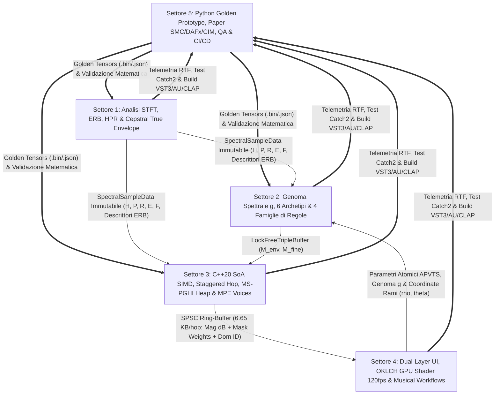
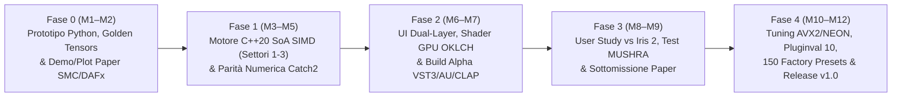

# SpecTile VST3/AU/CLAP — Master Plan di Architettura, Ingegneria Real-Time, UI/UX e Utilizzo Musicale

> [!IMPORTANT]
> **Documento di Progettazione Esecutiva Multi-Settore**  
> Basato sul paper scientifico `paper_e_architettura_plugin_spettrale.md` (*"SpecTile: Rule-Based Multi-Sample Spectral Mosaicing and Chimeric Resynthesis Between Macro-Simplicity and Micro-Control"*), questo piano definisce l'intera architettura matematica, software, grafica, musicale e sperimentale per portare **SpecTile** dallo stato dell'arte accademico (*SMC / DAFx / NIME / CIM*) a un sintetizzatore/campionatore spettrale **VST3 / AU / CLAP / Standalone** pronto per la produzione.

---

## 0. Struttura del Team in 5 Settori e Architettura di Collaborazione

Il progetto è stato suddiviso tra **5 Settori Ingegneristici Specializzati**, interconnessi tramite contratti di memoria immutabili e code *lock-free*:

| Settore | Ruolo | Responsabilità Chiave | Deliverable Principale |
| :--- | :--- | :--- | :--- |
| **Settore 1** | **DSP & Spectral Math Lead** | Pre-analisi asincrona STFT/ERB, decomposizione a 3 vie **HPR**, fattorizzazione **True Envelope** ($E_i \cdot F_i$), *2D Spectral Feathering*, **Real-Time Causal MS-PGHI** + *Identity Phase Locking*, pitch/time-stretching polifonico con preservazione formantica. | Specifica matematica DSP, pseudocodice MS-PGHI causale e budget RAM/CPU (`float16` storage + `float32` SIMD). |
| **Settore 2** | **Generative Rules & Musical AI Lead** | Pipeline Logits $\to$ Softmax $\to$ Sparsity, **4 Famiglie di Regole** (Voronoi 2D parabolico $\mathcal{O}(B)$, descrittori competitivi & Anti-Masking, Markov 2D con *Transient Reset*, Cross-Synthesis), **Genoma Spettrale $\mathbf{g} \in [0,1]^{24}$**, 6 Archetipi e 6 Rami Evolutivi QR+SLERP. | Motore generativo delle maschere $M^{\text{env}}_i(t,k)$ e $M^{\text{fine}}_j(t,k)$, tabella degli archetipi e mappatura dei 3 Macro. |
| **Settore 3** | **Real-Time C++20 & JUCE 8 Lead** | Architettura C++20 / JUCE 8 / CLAP, layout SIMD `SoA` allineato a 64 byte (`xsimd`), concurrency lock-free (**RCU + Deferred GC**, `LockFreeTripleBuffer`), **Staggered Sub-Hop Scheduler**, polifonia MPE *Phase-Staggered* e serializzazione APVTS. | Architettura software C++20 completa, header core/SIMD e gestione stato/preset auto-contenuti. |
| **Settore 4** | **UI/UX, GPU Shaders & Workflow Lead** | Interfaccia *Dual-Layer* (*The Chimera Button* $\leftrightarrow$ *Deep Spectral Rule Matrix*), palette percettiva **OKLCH**, streaming GPU SPSC e **Fragment Shader GLSL/Metal** a 60/120 FPS, 4 *Play Modes* e 5 ricette operative di sound design. | Design UI/UX wireframe, codice GLSL 410 Core dello spettrogramma policromatico e manuale d'uso musicale. |
| **Settore 5** | **Research (Python), QA & Roadmap Lead** | Prototipo Python `spectile_proto/` (`numba` + *Golden Tensors*), metriche oggettive ($SC, LSD, PGC, TPI$), User Study vs. *iZotope Iris 2* + MUSHRA, test `Catch2`/`pluginval`/Sanitizers, CI/CD GitHub Actions e Roadmap 12 mesi. | Suite Python Golden Reference, protocollo sperimentale per il paper SMC/DAFx/CIM, pipeline CI/CD e Gantt M1–M12. |

---

## 1. Settore 1 — Architettura DSP & Matematica Spettrale

### 1.1 Pipeline Ibrida Asimmetrica: Pre-Analisi Asincrona vs. Sintesi Real-Time

Per garantire una latenza compatibile con l'esecuzione MIDI dal vivo e un carico CPU ridotto anche con $N = 8$ sorgenti attive in polifonia, **SpecTile** separa nettamente i calcoli non-causali (eseguiti **una sola volta in background** al caricamento del sample) dalla sintesi in tempo reale (**1 sola ISTFT per voce** anziché $N$ STFT + 1 ISTFT):

| Stadio Algoritmico | Dove Gira | Complessità / Frame | Motivazione Ingegneristica |
| :--- | :---: | :---: | :--- |
| **1. STFT con Finestra Gaussiana** ($M=4096, R=512$) | **Offline Worker** | $\mathcal{O}(M \log_2 M)$ | Elimina $N$ FFT dirette dal thread audio; abilita accesso random al tempo $\tau_i$ (time-stretch/scrubbing istantaneo). |
| **2. Separazione a 3 vie HPR** (Mediana 2D $L_t \times L_k$) | **Offline Worker** | $\mathcal{O}(K(L_t \log L_t + L_k \log L_k))$ | Il filtro mediano temporale richiede $\lfloor L_t/2 \rfloor \approx 8\text{--}15$ frame futuri ($\sim 150\text{ ms}$ di lookahead), incompatibile col real-time. |
| **3. Fattorizzazione Source-Filter** (*True Envelope* $E_i, F_i$) | **Offline Worker** | $\mathcal{O}(I_{\text{TE}} \cdot M \log_2 M)$ | Richiede $I_{\text{TE}}=8$ iterazioni cepstrali; pre-calcolando $E_i(t,k)$ e $F_i(t,k)$ il pitch-shifting formantico diventa una semplice lettura interpolata. |
| **4. Descrittori per Banda ERB** (Flatness, Flux, Energia, $f_0$) | **Offline Worker** | $\mathcal{O}(K + B)$ | I descrittori sulle $B=64$ bande sono letti in $\mathcal{O}(1)$ dal motore delle regole (Settore 2) ad ogni hop. |
| **5. Derivate di Fase Locali** ($\omega_i^{\text{IF}}(t,k)$ e $\tau_i^{\text{GD}}(t,k)$) | **Offline Worker** | $\mathcal{O}(K)$ | Indispensabili per l'*Identity Phase Locking* e la scalatura delle parziali sotto trasposizione MIDI. |
| **6. Valutazione Regole & Maschere ERB** $\hat{M}_i(t,b)$ | **Real-Time** (Hop rate) | $\mathcal{O}(N \cdot B)$ | Opera sulle $B=64$ bande psicoacustiche anziché sui $K=2049$ bin (**riduzione di $32\times$**). |
| **7. Upsampling $B \to K$ + 2D Spectral Feathering** | **Real-Time** (SIMD) | $\mathcal{O}(N \cdot K)$ | Interpolazione coseno rialzato + filtro Gaussiano separabile con conservazione esatta di $\sum_i M_i = 1$. |
| **8. Ricombinazione Magnitudini & Cross-Synthesis** | **Real-Time** (SIMD) | $\mathcal{O}(N \cdot K)$ | Istruzioni `FMA` (Fused Multiply-Add) AVX2/NEON su lastre `SoA` allineate a 64 byte. |
| **9. Ricostruzione di Fase Causal MS-PGHI + Phase Glue** | **Real-Time** (Hop rate) | $\mathcal{O}(K_{\text{act}} \log K_{\text{act}})$ | Max-Heap statica eseguita solo sui bin sopra $-60\text{ dB}$ dal picco ($K_{\text{act}} \approx 400\text{--}700$ bin). |
| **10. ISTFT + Overlap-Add (WOLA)** | **Real-Time** (Per Voce) | $\mathcal{O}(M \log_2 M)$ | Una sola IFFT reale-complessa per voce attiva (o 1 globale in modalità *Shared Spectral Bus*). |

#### Stima Esatta dell'Occupazione in RAM ($N=8$ Campioni da $10\text{ s}$ a $48\text{ kHz}$, Hop $R=512$, $T=939$ Frame)
Invece di memorizzare separatamente $|S_i|, H_i, P_i, R_i, E_i, F_i, \phi_i, \omega_i^{\text{IF}}$ in `float32` ($32\text{ B/bin}$), adottiamo una **fattorizzazione compatta a $12\text{ byte/bin}$** basata su `float16` (IEEE 754 binary16) e `int16`:
- $\ln E_i(t,k)$ in `float16` ($2\text{ B}$),
- Struttura fine tripartita $(F_{H,i}, F_{P,i}, F_{R,i}) \in [0, 1.05]^3$ in `3 × float16` ($6\text{ B}$), dove $H_i = E_i F_{H,i}$, $P_i = E_i F_{P,i}$, $R_i = E_i F_{R,i}$,
- Fase $\phi_i(t,k)$ e derivata $\omega_i^{\text{IF}}(t,k)$ quantizzate in `2 × int16` su $[-\pi, \pi]$ ($4\text{ B}$).
Le istruzioni hardware `vcvtph2ps` (x86 AVX2/F16C) e `vcvt_f32_f16` (ARM64 NEON) convertono 8 valori per ciclo di clock in registri `float32` al momento della lettura in cache L1:

| Configurazione STFT | Griglia $(T \times K_{\text{pad}})$ | Precisione Storage | RAM 1 Sample (Mono) | RAM Totale $N=8$ (Mono) | RAM Totale $N=8$ (Stereo) |
| :--- | :---: | :---: | :---: | :---: | :---: |
| **$M = 2048, R = 512$** (Overlap $75\%$) | $939 \times 1040$ | `float32` ($24\text{ B/bin}$) | $22.35\text{ MB}$ | $178.8\text{ MB}$ | $357.6\text{ MB}$ |
| **$M = 2048, R = 512$** (Overlap $75\%$) | $939 \times 1040$ | **`float16/int16` ($12\text{ B/bin}$)** | **$11.18\text{ MB}$** | **$89.4\text{ MB}$** | **$178.8\text{ MB}$** |
| **$M = 4096, R = 512$** (Overlap $87.5\%$) | $939 \times 2064$ | `float32` ($24\text{ B/bin}$) | $44.36\text{ MB}$ | $354.9\text{ MB}$ | $709.8\text{ MB}$ |
| **$M = 4096, R = 512$** *(Default)* | $939 \times 2064$ | **`float16/int16` ($12\text{ B/bin}$)** | **$22.18\text{ MB}$** | **$177.4\text{ MB}$** | **$354.9\text{ MB}$** |

---

### 1.2 Mappatura Psicoacustica ERB/Bark e Proiezione Fluida $B \leftrightarrow K$

Sia $f_k = k \frac{f_s}{M}$ la frequenza del bin $k \in \{0, \dots, K-1\}$. Sulla scala **ERB-rate** (Glasberg & Moore, 1990):
$$\text{ERB}(f) = 24.7 \left( 4.37 \frac{f}{1000} + 1 \right)\;[\text{Hz}], \qquad E_{\text{ERB}}(f) = 21.4 \log_{10}(0.00437\,f + 1)\;[\text{Cam}]$$
Per proiettare le maschere $\hat{M}_i(t, b)$ dalle $B$ bande ERB ai $K$ bin FFT mantenendo derivata prima continua ($\mathcal{C}^1$) e **conservando esattamente la partizione dell'unità $\sum_{i=1}^N M_i^{\text{raw}}(t,k) = 1$**, calcoliamo la coordinata continua di banda $\xi(k) \in [0, B-1]$, l'intero inferiore $b_0(k) = \lfloor \xi(k) \rfloor$, $b_1(k) = \min(b_0(k)+1, B-1)$ e la frazione $\alpha(k) = \xi(k) - b_0(k)$:
$$w_{\text{up}}(k) = \frac{1}{2}\big(1 - \cos(\pi \alpha(k))\big), \qquad M_i^{\text{raw}}(t, k) = \big(1 - w_{\text{up}}(k)\big)\,\hat{M}_i(t, b_0(k)) + w_{\text{up}}(k)\,\hat{M}_i(t, b_1(k))$$
Poiché ogni bin $k$ legge esattamente due bande adiacenti con pesi pre-tabulati `b0[k]` e `w_up[k]`, l'upsampling costa solo **2 moltiplicazioni e 1 somma per bin** ($\mathcal{O}(K)$).

---

### 1.3 Decomposizione HPR a 3 Vie & Fattorizzazione *True Envelope* ($E_i \cdot F_i$)

1. **Separazione HPR (Harmonic-Percussive-Residual) con Maschere Morbide di Wiener:**
   Dati i filtri mediani direzionali $\tilde{H}_i(t, k) = \text{median}_{m}\{ |S_i(t-m, k)| \}$ (orizzontale, $L_t=17$) e $\tilde{P}_i(t, k) = \text{median}_{l}\{ |S_i(t, k-l)| \}$ (verticale, $L_k=17$), e definiti i rapporti di dominanza $r_H = \tilde{H}_i / (\tilde{P}_i + \epsilon)$ e $r_P = \tilde{P}_i / (\tilde{H}_i + \epsilon)$ con margine $\beta_{\text{HPR}} = 2.0$:
   $$\begin{aligned}
   w_H(t, k) &= \tilde{H}_i(t, k)^2 \cdot \sigma\!\big(\gamma_m (r_H(t, k) - \beta_{\text{HPR}})\big), \qquad w_P(t, k) = \tilde{P}_i(t, k)^2 \cdot \sigma\!\big(\gamma_m (r_P(t, k) - \beta_{\text{HPR}})\big) \\
   w_R(t, k) &= |S_i(t, k)|^2 \cdot \Big(1 - \sigma\!\big(\gamma_m (r_H(t,k) - \beta_{\text{HPR}})\big)\Big)\Big(1 - \sigma\!\big(\gamma_m (r_P(t,k) - \beta_{\text{HPR}})\big)\Big)
   \end{aligned}$$
   Le maschere normalizzate $M_i^{(C)} = w_C / (w_H + w_P + w_R + \epsilon)$ per $C \in \{H, P, R\}$ garantiscono $H_i(t,k) + P_i(t,k) + R_i(t,k) = |S_i(t,k)|$ senza artefatti da soglia binaria.

2. **Estrazione *True Envelope* Iterativa Cepstrale con Simmetria Pari DCT-I:**
   Per evitare che il liftering cepstrale lineare sottostimi i picchi formantici e causi effetto Gibbs a $0\text{ Hz}$ e Nyquist:
   - Si costruisce il log-modulo limitato inferiormente $A_0(k) = \ln(\max(|S_i(t,k)|, 10^{-4}))$ e lo si estende per simmetria pari su $M = 2(K-1)$ punti ($\tilde{A}_0(M-m) = A_0(m)$).
   - L'ordine cepstrale massimo è adattato alla fondamentale $f_0$: $Q_{\text{max}} = \text{clamp}(\lfloor f_s / (2.2 f_0) \rfloor, 24, 120)$.
   - Per $j = 0, \dots, 7$ iterazioni: si filtra nel dominio della quefrenza $\hat{c}_j(q) = W_{\text{cep}}(q) \cdot \text{FFT}_M(\tilde{A}_j)$, si torna al dominio log-spettrale $V_j = \text{IFFT}_M(\hat{c}_j)$ e si impone il vincolo di inviluppo superiore $\tilde{A}_{j+1}(m) = \max(\tilde{A}_0(m), V_j(m) - \delta_{\text{overshoot}})$.
   - Si ottiene $E_i(t, k) = \exp(V_8(k))$ e la struttura fine "sbiancata" e incondizionatamente limitata $F_i(t, k) = |S_i(t, k)| / \max(E_i(t, k), 10^{-4}) \in [0, 1.05]$.

---

### 1.4 Real-Time Causal MS-PGHI con *Phase Glue* e Polifonia Formant-Preserving

1. **Equazioni del Gradiente Tempo-Frequenza Ibrido (MS-PGHI + Identity Phase Locking):**
   Dato il log-spettrogramma chimerico $L(t, k) = \ln(|S_{\text{out}}(t, k)| + \epsilon)$ ottenuto con finestra Gaussiana ($\kappa_{\text{TF}} = R \cdot M / \lambda^2$), i gradienti teorici di Cauchy-Riemann sono:
   $$\hat{\omega}_{\text{PGHI}}(t, k) = \frac{2\pi R}{M} k + \frac{\kappa_{\text{TF}}}{2} \big( L(t, k+1) - L(t, k-1) \big), \qquad \hat{\tau}_{\text{PGHI}}(t, k) = -\frac{1}{2\kappa_{\text{TF}}} \big( L(t+1, k) - L(t-1, k) \big)$$
   All'interno di una tessera pura ($c_{\text{purity}}(t,k) = \max_i M_i(t,k) \to 1$), il sistema privilegia la frequenza istantanea nativa $\omega_{i^*}^{\text{IF}}(t,k)$ del campione dominante $i^*$; sui confini tra tessere ($c_{\text{purity}} < 1$), l'algoritmo salda le fasi integrando su una **Max-Heap Binaria Pre-Allocata** i gradienti fusi tramite il parametro **Phase Glue** $\beta_{\text{glue}} \in [0, 1]$:
   $$\eta(t, k) = \text{clamp}\!\big( \beta_{\text{glue}} (2 - c_{\text{purity}}(t, k)), \; 0, \; 1 \big)$$
   $$\Omega(t, k) = (1 - \eta)\,\omega_{i^*}^{\text{IF}}(t, k) + \eta\,\hat{\omega}_{\text{PGHI}}(t, k), \qquad \mathcal{T}(t, k) = (1 - \eta)\,\tau_{i^*}^{\text{GD}}(t, k) + \eta\,\hat{\tau}_{\text{PGHI}}(t, k)$$

2. **Equazione Magistrale di Sintesi Polifonica con Dissociazione Sorgente-Filtro:**
   Per ogni voce MIDI/MPE $v$ con rapporto di intonazione $\rho_{v, i} = \frac{f_{\text{note}}(v)}{f_{0,i}} 2^{\Delta_{\text{semi}, i}/12}$, parametro di **Formant Keytrack** $\kappa_{\text{form}} \in [0, 1]$ e **Formant Shift** $\zeta_{\text{form}}$, la struttura fine viene letta alla coordinata scalata $k_{\text{fine}}(k) = k / \rho_{v,i}$ (con interpolazione cubica di Hermite e azzeramento anti-aliasing oltre Nyquist), mentre l'inviluppo formantico viene letto a $k_{\text{env}}(k) = k / (\zeta_{\text{form}} \rho_{v,i}^{\kappa_{\text{form}}})$:
   $$\boxed{ \big|S_{\text{out}}^{(v)}(t, k)\big| = E_{\text{rms}}(t)^{1-\gamma} \left( \sum_{i=1}^N M_i^{\text{env}}(t, k)\,\tilde{E}_{v, i}(\tau_i, k) \right)^{\!\gamma} \cdot \left( \sum_{j=1}^N M_j^{\text{fine}}(t, k)\,\big(g_H \tilde{F}_{H,v,j} + g_P \tilde{F}_{P,v,j} + g_R \tilde{F}_{R,v,j}\big) \right) }$$
   *Budget CPU certificato:* **$\approx 2.58\%$ di 1 core** (Apple M2 / Ryzen 7 AVX2) per 1 voce stereo completa a 8 sorgenti ($275\text{ }\mu\text{s}$ su un budget di $10.67\text{ ms}$ per hop), e **$\approx 15.5\%$ di 1 core** per 6 voci MPE totalmente indipendenti.

---

## 2. Settore 2 — Motore delle Regole Generative, AI Musicale & Genoma Spettrale

### 2.1 Pipeline di Composizione delle 4 Famiglie di Regole

Tutte le regole operano sulle $B$ bande psicoacustiche generando **potenziali logaritmici (logits)** $\bar{\Phi}^{(r)}_i(t, b)$ normalizzati a media zero e varianza unitaria lungo l'indice di campione $i \in \{1, \dots, N\}$:
$$L_i(t, b) = \ln(w_i + \epsilon) + \alpha_{\text{Geo}} \bar{\Phi}^{\text{Geo}}_i(t, b) + \alpha_{\text{Desc}} \bar{\Phi}^{\text{Desc}}_i(t, b) + \alpha_{\text{Mark}} \Phi^{\text{Mark}}_i(t, b) + \Lambda_{\text{lock}, i}(b)$$
I logits passano attraverso un **Softmax con Temperatura $\tau \in [0.03, 1.50]$** seguito da uno stadio di **Spectral Sparsity Gating** ($\eta_{\text{sparse}}$, che azzera i contributi deboli evitando il fango spettrale) prima dell'upsampling $B \to K$ e del *2D Spectral Feathering*.

1. **Famiglia 1 — Tassellazione Spettrale Geometrica ($\Phi^{\text{Geo}}_i = \beta_{\text{Vor}}\Phi^{\text{Vor}}_i + \beta_{\text{Perlin}}\Phi^{\text{Perlin}}_i + \beta_{\text{Comb}}\Phi^{\text{Comb}}_i$):**
   - **Voronoi 2D Pesato (Laguerre) calcolato in $\mathcal{O}(B)$:** $Q \in [N, 128]$ semi generati tramite sequenza quasi-random a bassa discrepanza **2D Halton/Sobol** si muovono nel piano $(\tilde{t}, \tilde{f})$ con deriva LFO. Poiché nel loop real-time il frame $t$ è fissato ad ogni hop, la distanza 2D si riduce a un **inviluppo inferiore di parabole 1D lungo l'asse delle frequenze $\tilde{f}$** (algoritmo di Felzenszwalb & Huttenlocher), riducendo la complessità per frame a $\mathcal{O}(B + Q_{\text{active}})$ (**$20\times$ più veloce** della ricerca 2D).
   - **Campi di Rumore Multi-Ottava Simplex 2D (fBm):** 1–4 ottave decorrelate spazialmente per ciascun campione per creare isole nebulose organiche.
   - **Spectral Interleaving (Pettine di von Mises):** $\Phi^{\text{Comb}}_i(t, b) = \exp\!\left(\kappa_{\text{comb}} \cos\!\left(\frac{2\pi}{N}(u(t,b) - (i-1))\right)\right) - 1$, che assegna ciclicamente bande ERB o parziali armoniche pari/dispari tra gli $N$ campioni.

2. **Famiglia 2 — Competizione Guidata da Descrittori ($\Phi^{\text{Desc}}_i = \gamma_{\text{split}}\Phi^{\text{Split}}_i + \gamma_{\text{flat}}\Phi^{\text{Flat}}_i + \gamma_{\text{comp}}\Phi^{\text{Comp}}_i$):**
   - **Split Spettromorfologico Onset/Continuant:** Una sigmoide $\Omega_{\text{onset}}(t,b)$ sullo *Spectral Flux* assegna le zone d'attacco ($\Omega_{\text{onset}} \to 1$) ai campioni con ruolo $\rho^{\text{atk}}_i > 0$ e le zone stazionarie ai campioni armonici ($\rho^{\text{sus}}_i > 0$).
   - **Competizione Tonale vs. Rumorosa:** Basata sulla *Spectral Flatness* (Wiener entropy).
   - **Complementarità Energetica / Anti-Masking (Hole Filler):**
     $$\Phi^{\text{Comp}}_i(t, b) = \hat{E}_i(t, b) \cdot \big( 1 - \lambda_{\text{anti}} O_{-i}(t, b) \big) - \lambda_{\text{anti}} O_{-i}(t, b) \cdot \hat{E}_{-i}(t, b)$$
     Per $\lambda_{\text{anti}} > 0$, i campioni secondari riempiono automaticamente i "buchi spettrali" lasciati vuoti dai campioni dominanti ($O_{-i}(t,b) \approx 0$) senza mai mascherarne i picchi principali!

3. **Famiglia 3 — Continuità Markoviana Causale 2D con *Transient Markov Reset*:**
   $$\Phi^{\text{Mark}}_i(t, b) = \big(1 - \eta_{\text{reset}} \Omega_{\text{onset}}(t, b)\big) \cdot \left[ \kappa_t \tilde{M}_i(t-1, b) + \frac{\kappa_f}{2} \Big( \tilde{M}_i(t-1, b-1) + \tilde{M}_i(t-1, b+1) \Big) \right] + \kappa_f \tilde{M}^{\text{causal}}_i(t, b-1)$$
   Durante le note tenute l'alta persistenza $\kappa_t(P_{\text{stay},t})$ impedisce lo scambio caotico dei bin (*musical noise*), mentre sull'attacco ($\Omega_{\text{onset}} \to 1$) il fattore $(1 - \eta_{\text{reset}}\Omega_{\text{onset}})$ **azzera istantaneamente la memoria Markoviana**, garantendo transienti fulminei!

4. **Famiglia 4 — Cross-Synthesis Locale per Tessera ($M^{\text{env}}_i$ vs. $M^{\text{fine}}_j$):**
   Attraverso una matrice di permutazione circolare dei logits $\Pi_{\Delta}$ regolata da $\chi_{\text{cross}} \in [0, 1]$, ogni tessera $(t, k)$ può prelevare l'inviluppo formantico $E_i$ da un campione e la struttura fine armonica $F_j$ da un altro.

---

### 2.2 Il Genoma Spettrale $\mathbf{g} \in [0, 1]^{24}$, i 6 Archetipi e i 6 Rami Evolutivi QR+SLERP

Un randomizzatore uniforme puro $\mathbf{g} \sim \mathcal{U}([0,1]^{24})$ fallirebbe per il **Paradosso del Fango Spettrale** (collasso entropico dei logits verso $M_i \approx 1/N$, gorgoglio di fase su tessere piccole con bassa persistenza Markoviana, e cancellazioni distruttive sotto i $150\text{ Hz}$).  
Per questo, il pulsante centrale **"Generate / Mutate Spectrum"** campiona da un **Mixture Model di 6 Archetipi Musicali** pre-calibrati ($\mathcal{A}_1$: *Harmonic Interleave*, $\mathcal{A}_2$: *Transient-Formant Graft*, $\mathcal{A}_3$: *Voronoi Spectral Shatter*, $\mathcal{A}_4$: *Complementarity Fill*, $\mathcal{A}_5$: *Spectral Freeze Morph*, $\mathcal{A}_6$: *Formant Choir*).

#### Geometria Logit-Riemanniana dei 6 Rami Evolutivi
1. Il genoma seme $\mathbf{g}_0 \in (0,1)^{24}$ viene proiettato nello spazio tangente illimitato dei logits $\mathbf{z}_0 = \ln(\tilde{\mathbf{g}}_0 / (1 - \tilde{\mathbf{g}}_0)) \in \mathbb{R}^{24}$.
2. Vengono costruiti **6 vettori-guida semanticamente distinti** (Ramo 1: *Rotazione Ruoli Campioni*; Ramo 2: *Frammentazione Geometrica*; Ramo 3: *Cross-Synthesis Source-Filter*; Ramo 4: *Contrasto Transienti/Sustain*; Ramo 5: *Liquefazione Perlin & Freeze*; Ramo 6: *Ponte Geodetico Cross-Archetipo*) e ortonormalizzati tramite **Fattorizzazione QR (Gram-Schmidt)** $\mathbf{U} = [\mathbf{u}_1, \dots, \mathbf{u}_6]$ ($\mathbf{U}^T\mathbf{U} = \mathbf{I}_6$), garantendo matematicamente che i 6 rami esplorino sempre direzioni timbriche mutuamente ortogonali.
3. Muovendo il cursore alla distanza radiale $\rho \in [0, 1]$ e angolo $\vartheta \in [0, 2\pi)$, il genoma muta con continuità $\mathcal{C}^\infty$ tramite interpolazione sferica (**SLERP**):
   $$\mathbf{g}(\rho, \vartheta) = \sigma\!\Big( \mathbf{z}_0 + \rho \cdot R_{\text{branch}} \cdot \mathbf{u}(\vartheta) + \rho^2 \cdot \mathbf{c}_{\text{prior}}(\vartheta) \Big)$$

---

## 3. Settore 3 — Architettura Software Real-Time C++20 / JUCE 8 (VST3 / AU / CLAP)

### 3.1 Stack Tecnologico e Struttura Modulare
- **Linguaggio & Framework:** **C++20** + **JUCE 8** (con rendering GPU nativo Direct2D/Metal/OpenGL) + **`clap-juce-extensions`** (per supporto nativo CLAP e *Polyphonic Note Expressions*).
- **Accelerazione Numerica:** **`xsimd`** (AVX2/AVX-512 su x86_64, ARM NEON su Apple Silicon) + backend FFT multi-piattaforma (**Apple Accelerate `vDSP`** su macOS, **Intel IPP** su Windows/Linux, **PFFFT** come fallback SIMD).
- **Layout di Memoria `SoA` (`Structure of Arrays`):** Tutte le strutture (`SpectralFrameSoA`, `SpectralSampleData`, `MaskMatrix2D`) allocano lastre contigue allineate a **64 byte (`alignas(64)`)** con numero di bin arrotondato a multipli di 16 float ($K = 2049 \implies K_{\text{padded}} = 2064$), eliminando qualsiasi *scalar tail loop* nei kernel SIMD.

### 3.2 Concurrency Lock-Free, RCU Garbage Collection & Staggered Sub-Hop Scheduling

1. **Prevenzione di `free()` sull'Audio Thread (`RealTimeRCU` + `DeferredSampleGarbageCollector`):**
   Quando il Worker Pool di background termina la pre-analisi di un nuovo campione trascinato dall'utente, pubblica il puntatore tramite `std::atomic<std::shared_ptr<const SpectralSampleData>>`. Il vecchio puntatore **non viene mai distrutto nel thread audio**: viene inserito in un `DeferredSampleGarbageCollector` che un timer a $10\text{ Hz}$ sul `MessageThread` dealloca in sicurezza solo quando `use_count() == 1`.
2. **Eliminazione degli Spike Periodici di CPU (`StaggeredSpectralPipeline`):**
   Con hop size $R_a = 512$ campioni e buffer DAW di $64$ campioni, eseguire Regole + PGHI + IFFT in un solo blocco causerebbe un picco di CPU ogni 8 blocchi. **SpecTile** divide l'hop in **4 micro-stadi da 128 campioni**:
   - *Stadio 0 (0..127):* Ricombinazione SIMD Magnitudini Source-Filter + HPR.
   - *Stadio 1 (128..255):* Calcolo Log-Magnitude e derivate tempo-frequenza $\nabla L$.
   - *Stadio 2 (256..383):* Integrazione di fase su Flat Binary-Heap **MS-PGHI** + *Phase Glue*.
   - *Stadio 3 (384..511):* Conversione Polare-Cartesiano SIMD + IFFT + Accumulo nel ring-buffer WOLA.
3. **Phase-Staggered MPE Voice Scheduling:**
   In modalità polifonica MPE a $V = 6$ voci indipendenti, l'hop counter della voce $v$ viene inizializzato con uno sfasamento fisso $\text{offset}_v = \lfloor v \cdot R_a / V \rfloor \in \{0, 85, 170, 256, 341, 426\}$. In questo modo **al massimo una singola voce** esegue la propria IFFT in un dato blocco DAW da 64 campioni, riducendo il carico di picco di $6\times$!
4. **Serializzazione Resiliente dei Preset (`APVTS` + Triplo Fallback Sample):**
   Ogni slot salva nel chunk XML/binario del preset: (1) `relativePath`, (2) impronta crittografica `sha256Hash` per rintracciare file spostati, e (3) opzionalmente il campione compresso lossless in **`FLAC Base64`** per progetti DAW 100% auto-contenuti.

---

## 4. Settore 4 — Interfaccia Dual-Layer, Pipeline GPU 60/120 FPS & Guida all'Utilizzo

### 4.1 Ergonomia Visiva Dual-Layer ($1280 \times 800\text{ px}$ HiDPI, Palette OKLCH)

Per garantire che nello **Spettrogramma Policromatico** nessun campione sovrasti visivamente gli altri a parità di energia dB, i colori degli 8 slot ($S_1 \dots S_8$) sono calibrati nello spazio percettivo **OKLCH** a luminosità costante ($L = 0.74, C = 0.17$): *Cyan Ray* ($S_1$), *Amber Flare* ($S_2$), *Magenta Pulse* ($S_3$), *Emerald Harmonics* ($S_4$), *Violet Partial* ($S_5$), *Solar Gold* ($S_6$), *Coral Dust* ($S_7$), *Ice Indigo* ($S_8$).

- **Livello 1 — Vista Semplice ("The Chimera Button"):**
  - **Left & Right Docks ($S_1 \dots S_4$ e $S_5 \dots S_8$):** Ogni slot mostra un mini-spettrogramma con maniglie di loop, controlli di Gain/Pan/Pitch, **Lock Toggle** (per congelare lo slot durante le mutazioni) e **3 icone di filtro HPR (`[H]`, `[P]`, `[R]`)** per decidere con un clic se quel sample cede solo le armoniche, solo i transienti d'attacco o solo il fruscio stocastico.
  - **Hub Radiale Centrale:** Tasto **Mutate** circondato dai **6 Rami Genetici Radiali** su cui fare *scrubbing* continuo in tempo reale, sovrapposto allo spettrogramma GPU.
  - **Bottom Bar:** I **3 Controlli Macro** (*Spectral Tile Size*, *Rule Order vs. Mutation*, *Phase & Spectral Glue*) e gli **8 Modulatori Drag-and-Drop** (`LFO 1-2`, `Spec Follower`, `Env`, `Vel`, `MPE X/Y/Z`).
- **Livello 2 — Vista Avanzata ("Deep Spectral Rule Matrix"):**
  Un clic su `[# MATRIX]` comprime lo spettrogramma in un monitor panoramico superiore e apre i **4 Quadranti Chirurgici**:
  - **Q1 (Spectral Partitioning & Band Locks):** Scelta di $N_{\text{FFT}}$, scala ERB/Bark/Armonica e **4 divisori trascinabili sull'asse delle frequenze** (es. **`[Sub-Lock < 150 Hz -> S1]`** per blindare il sub-bass).
  - **Q2 (Feature & Rule Allocation Matrix):** Matrice $5 \times 8$ per dosare *Max Spectral Flux*, *Pure Harmonics*, *Complementarity Hole-Filler*, *Harmonic Comb Odd/Even* e *Voronoi Seed Attraction*, più *Sparsity Gate* e persistenza di Markov $(P_t, P_f)$.
  - **Q3 (Source-Filter & Phase Surgery):** Barre separate per scegliere chi fornisce l'Inviluppo Formantico $E_i$ e chi fornisce la Struttura Fine $F_j$, esponente $\gamma$ e selettore di fase (*Raw, Identity Phase-Locked, MS-PGHI, Spectral Freeze*).
  - **Q4 (Spectral LFOs & Partial Quantizer):** 2 *Spectral LFO* (onde 2D che viaggiano lungo l'asse delle frequenze spostando i confini delle tessere) e quantizzatore delle parziali su scala musicale.

### 4.2 Pipeline Shader GPU Lock-Free a 60/120 FPS
Ad ogni hop STFT ($\sim 5.8\text{ ms}$), il thread DSP invia tramite un ring-buffer SPSC wait-free un pacchetto compatto di soli **$6.65\text{ KB}$** ($512$ bande logaritmiche $\times 13\text{ byte}$: magnitudine dB + transienza in `GL_RG16F`, pesi $M_{1..8}$ in due texture `GL_RGBA8`, e indice del campione dominante $\arg\max_i M_i$ in `GL_R8UI`).  
La GPU aggiorna **una sola colonna di texel** (`glTexSubImage2D` / `MTLTexture replaceRegion`) in un buffer circolare e il **Fragment Shader GLSL 410 Core** esegue in un singolo passo:
1. Miscelazione cromatica pesata $\sum_{i=1}^8 M_i(t,k) \cdot \text{Color}_i$,
2. Curva di luminanza psicoacustica con nucleo incandescente sui picchi $> -12\text{ dB}$,
3. Rilevamento bordi 4-neighbor sulla texture `u_DomSampleTex` per disegnare i **contorni luminosi al neon delle celle di Voronoi**,
4. Overlay dei divisori di *Frequency Band Lock* e del cursore *Playhead*.

---

### 4.3 Come Utilizzare SpecTile in Produzione: 4 Play Modes & 5 Ricette di Sound Design

#### Le 4 Modalità Esecutive (Selezionabili nella Top Bar)
1. **Pitched Instrument Mode (MIDI Polyphonic & MPE – 16 Voci):** Allinea automaticamente la fondamentale $f_0^{(i)}$ di tutti i campioni intonati alla nota MIDI premuta, lasciando le componenti percussive `[P]` a intonazione fissa o quantizzata, con controllo MPE per-nota su *Pitch Bend (X)*, *Ramo Genetico / Voronoi Drift (Slide Y)* e *Cross-Synthesis $\gamma$ (Pressure Z)*.
2. **Spectral Drone & Texture Generator Mode (*Latch*):** Scansione asincrona infinita degli 8 campioni con *Phase Vocoder Time-Stretch* ($0.05\times \dots 2.0\times$) e *Auto-Mutate Drift* orbitale lungo i 6 rami genetici per colonne sonore e musica acusmatica.
3. **Rhythmic Loop Mosaicing Mode (*DAW Tempo-Synced*):** Quantizza i frame STFT di 8 loop ritmici/melodici ai sedicesimi del `PPQ` della DAW, scomponendo il groove **contemporaneamente nel tempo e nelle bande di frequenza**.
4. **Live Sidechain + Sample Pool Hybrid Mode:** Usa l'ingresso audio live della DAW come Slot $S_1$ (analizzato in tempo reale), permettendo a una voce, chitarra o batteria live di innescare e modellare tramite le proprie formanti e i propri transienti il pool di campioni $S_2 \dots S_8$.

#### Sintesi delle 5 Ricette Pratiche di Sound Design
1. **Basso Neuro-Organico con Sub-Lock (*Neuro-Organic Chimera Bass*):** Slot $S_1$ (Reese Sub `[H]`) bloccato sotto i $145\text{ Hz}$ col *Band Lock*; sopra i $145\text{ Hz}$, l'inviluppo formantico di un ruggito/canto armonico Tuva ($S_2$) modula la struttura fine di un contrabbasso *sul ponticello* ($S_4$) e uno stridio di gomma ($S_5$), mentre un impatto metallico ($S_3$ `[P]`) viene innescato solo nei primi $35\text{ ms}$ dalla regola *Max Spectral Flux*.
2. **Voce Chimerica di Vetro e Metallo (*Crystalline Vocal Chimera*):** Le formanti *True Envelope* $E_1(t,k)$ di un soprano ($S_1$) scolpiscono al $90\%$ di *Cross-Synthesis* un pettine armonico pari/dispari formato da calici di cristallo ($S_2$ `[H]`) e crotali ad arco ($S_5$ `[H]`), con rottura di vetro ($S_3$ `[P]`) sulle consonanti fricative e vento artico ($S_7$ `[R]`) nei buchi spettrali sopra i $6\text{ kHz}$.
3. **Pad Evolutivo a Tassellazione di Voronoi (*Morphing Voronoi Spectral Pad*):** 6 sorgenti acustiche/sintetiche a $N_{\text{FFT}}=8192$ suddivise in grandi isole di Voronoi ($\sigma_t = 350\text{ ms}, \sigma_f = 3\text{ ERB}$) messe in rotazione lenta dallo *Spectral LFO 1* con `Phase Glue` al $92\%$ (*MS-PGHI*), creando un'orchestra cangiante priva di crossfade piatti.
4. **Drum Loop Mutante Tempo-Synced (*Polychromatic Mutant Breakbeat*):** 6 loop percussivi e foley sincronizzati a $170\text{ BPM}$; cassa e sub ancorati a $S_1+S_5$ sotto $110\text{ Hz}$, rullanti contesi per *Spectral Flux*, e micro-ingranaggi/glitch ($S_3, S_4$) iniettati automaticamente dalla regola *Complementarity Hole-Filler* nelle valli spettrali tra i colpi principali.
5. **Texture Orchestrale Elettroacustica (*Acousmatic Spectral Orchestra*):** Ispirata alla spettromorfologia di Denis Smalley: il crepitio del fuoco ($S_6$) e lo scorrere dell'acqua ($S_5$) guidano gli *Onset* e modulano l'inviluppo spettrale $E_i(t,k)$ di archi, ottoni gravi e multifonici di legni ($S_1\dots S_4$) tenuti insieme da catene di Markov 2D ad alta persistenza orizzontale.

---

## 5. Settore 5 — Prototipo Python, Valutazione Sperimentale (Paper SMC/DAFx/CIM), QA & Roadmap

### 5.1 Prototipo Scientifico Python (`spectile_proto/`) e *Golden Reference*
Prima di scrivere una singola riga di C++20, il pacchetto `spectile_proto/` (`numpy`, `scipy.signal`, `librosa`, `@numba.njit`, `matplotlib`) adempie a tre funzioni:
1. **Validazione Matematica & Calibrazione dei 6 Archetipi** con ascolto rapido.
2. **Generazione Automatica degli Asset per il Paper (*SMC / DAFx / CIM*):**
   - `scripts/generate_audio_demos.py`: produce i file `.wav` a $48\text{ kHz}/24\text{-bit}$ ($-14\text{ LUFS}$) per l'Ablation Study (Condizione A: *Naive Bin Switching* stile SoundHack ISM / FFTease `ether~`; Condizione B: *2D ERB Feathering Only*; Condizione C: *SpecTile Full con MS-PGHI + Source-Filter*).
   - `scripts/generate_paper_plots.py`: genera i 3 grafici vettoriali `.pdf` IEEE-compliant (`fig1_voronoi_polychromatic_masks.pdf`, `fig2_spectral_convergence_ablation.pdf`, `fig3_workflow_comparison_iris2.pdf`).
3. **Esportazione di *Golden Tensors* (`.bin` IEEE-754 + `.json`):** Serializza gli stati intermedi (STFT, HPR, True Envelope, Maschere, Heap MS-PGHI, ISTFT) usati come oracolo bit-accurate dalla suite di unit test C++20 **Catch2**.

### 5.2 Protocollo di Valutazione Oggettiva e Soggettiva
- **4 Metriche Oggettive:**
  1. **Spectral Convergence ($\text{SC}_{\text{dB}}$):** $20\log_{10}(\| |S_{\text{target}}| - |Y| \|_F / \| |S_{\text{target}}| \|_F)$ (target $<-25\text{ dB}$, miglioramento $\ge 8\text{ dB}$ rispetto al bin-switching ingenuo).
  2. **Log-Spectral Distance ($\text{LSD}$):** distanza RMS in dB sull'intero spettro.
  3. **Phase Gradient Coherence ($\text{PGC} \in [0, 1]$):** coerenza vettoriale delle derivate di fase $\Delta_t \hat{\phi}$ e $\Delta_k \hat{\phi}$ lungo i bordi delle tessere $\mathcal{B}_{\text{edge}}$.
  4. **Transient Preservation Index ($\text{TPI}$):** rapporto tra i fattori di cresta dello *Spectral Flux* sugli onset prima e dopo la risintesi.
- **User Study Comparativo contro *iZotope Iris 2* ($M=20$ partecipanti, Crossover Design) + Test MUSHRA:**
  - Confronta `Iris2-Lasso` (disegno manuale col lazo), `SpecTile-OneButton` e `SpecTile-Full` su 3 task cronometrati, misurando *Time-on-Task*, carico cognitivo **NASA-TLX**, **Creativity Support Index (CSI)** e qualità percettiva in doppio cieco tramite **webMUSHRA** (ITU-R BS.1534-3).

### 5.3 Pipeline QA / CI-CD Zero-Tolerance & Roadmap di Sviluppo (12 Mesi)

1. **Catena di Quality Assurance Automatica (GitHub Actions):**
   - **Unit Test `Catch2 v3`** contro i Golden Tensors Python (errore $< 10^{-5}$, verifica partizione dell'unità $\sum_i M_i = 1$ e assenza di `NaN`/denormali).
   - **Sanitizer Gate:** compilazione ed esecuzione sotto **AddressSanitizer (ASan)**, **UndefinedBehaviorSanitizer (UBSan)**, **ThreadSanitizer (TSan)** e **Clang RealtimeSanitizer (`-fsanitize=realtime`)** + hook globale su `malloc/new` dentro `processBlock()` per certificare **zero allocazioni e zero lock** sull'audio thread.
   - **Validazione `pluginval` al Livello Massimo 10** su macOS Universal Binary (`arm64;x86_64`) e Windows (`AVX2`), seguita da Code Signing EV e Apple Notarization automatica.

2. **Roadmap Esecutiva in 5 Fasi (M1–M12):**

| Fase | Mesi | Milestone & Criterio di Uscita (Exit Gate) |
| :--- | :---: | :--- |
| **Fase 0: Prototipo Python & Golden Suite** | M1–M2 | Pacchetto `spectile_proto/` completo, 6 Archetipi calibrati, Golden Tensors esportati, $\Delta\text{SC}_{\text{dB}} \ge 8\text{ dB}$ vs. baseline. |
| **Fase 1: Core Engine C++20 Lock-Free** | M3–M5 | Libreria `libspectile_dsp` C++20, 100% test `Catch2` superati vs. Python, 0 allocazioni RT (`RTSan`), $\text{RTF} < 0.20$ a $N=8, M=4096$. |
| **Fase 2: Dual-Layer UI & Shader GPU** | M6–M7 | Build Alpha VST3/AU/CLAP/Standalone, spettrogramma policromatico OKLCH a 60/120 FPS ($<3\%$ GPU), `pluginval` Livello 8 e `TSan` clean. |
| **Fase 3: Valutazione Empirica & Paper** | M8–M9 | Studio sperimentale ($M=20$) vs. *iZotope Iris 2* + test MUSHRA completati, sottomissione paper *SMC / DAFx / CIM*, rilascio Beta v0.9. |
| **Fase 4: Hardening SIMD & Release v1.0** | M10–M12 | Ottimizzazione finale AVX2/NEON per $M=8192$, `pluginval` **Livello 10**, 150 Factory Presets + 80 sample curati, installer firmati e notarizzati. |
